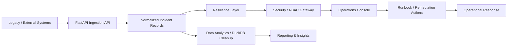

# FDE Stack Architecture Overview

## Summary
The FDE stack is a learning-focused, end-to-end example of how an enterprise operations platform can be assembled from multiple small services and workflows. Each module covers a different layer of the stack, from ingestion and validation to resilience, identity, operations, and analytics.

## End-to-end flow

## Layer-by-layer explanation

### 1. Ingestion and normalization
The first layer is the FastAPI service in [day1_2_fastapi](day1_2_fastapi).

This service receives noisy or legacy-style incident payloads and normalizes them before they are accepted into the system. It focuses on:
- strict request validation
- correlation IDs for traceability
- standardized severity mapping
- timestamp metadata
- in-memory record storage for demo purposes

This layer is the entry point for operational event data.

### 2. Resilience against flaky dependencies
The second layer is demonstrated in [day3_flaky_legacy](day3_flaky_legacy).

This module simulates a legacy enterprise dependency that may fail randomly or rate-limit requests. It shows how to protect the backend from unreliable upstream systems with:
- retry logic with exponential backoff
- jitter to avoid retry storms
- circuit breakers to isolate failing dependencies
- graceful handling of intermittent 429/5xx responses

This layer ensures the stack does not fail catastrophically when external systems are unstable.

### 3. Identity and authorization
The security layer is implemented in [day4_oidc_and_rbac](day4_oidc_and_rbac).

This module models a minimal JWT-based identity flow and enforces role-based access control. It covers:
- JWT issuance for demo users
- token validation and expiry checks
- security dependencies for protected routes
- route-level RBAC using roles such as `ops_viewer`, `sec_auditor`, and `fde_admin`

This layer protects operational APIs and ensures only authorized users can execute sensitive actions.

### 4. Operations console
The human-facing operations UI lives in [day5_7_ops_ui](day5_7_ops_ui).

This module provides a streamlined operational dashboard that:
- shows live incident data
- filters by tenant or operator context
- summarizes KPIs and latency
- simulates runbook execution
- blocks unauthorized actions through RBAC checks

This layer is the interface between engineers and the platform’s backend services.

### 5. Data cleaning and analytics
The analytics layer is in [day8_9_data_analytics](day8_9_data_analytics).

This module deals with real-world dirty data and demonstrates how to prepare it for analysis with DuckDB. It covers:
- duplicate row removal
- normalization of inconsistent identifiers
- numeric validation and filtering bad values
- export to Parquet for downstream analysis

This layer turns raw, messy enterprise data into structured analytics-ready records.

## How the pieces fit together

The full flow is conceptualized as follows:

1. External or legacy systems send operational events.
2. The API ingestion service validates and normalizes them.
3. The service ensures upstream reliability with retry and circuit breaker logic.
4. Protected endpoints enforce authorization through JWT and RBAC.
5. Operators use the dashboard to inspect and act on incident data.
6. Analytics pipelines clean dirty datasets so reporting and dashboards become trustworthy.

## Design intent
This repository is intentionally modular and demonstration-friendly rather than a full enterprise deployment. It illustrates common engineering patterns that appear in real operational stacks:
- observability
- defensive programming
- identity-aware access
- operations UX
- data hygiene for analytics

## Practical takeaway
Each folder is a reusable building block. Together they form a coherent narrative: from receiving noisy enterprise data, to making systems resilient, to securing actions, to surfacing insights in an operations UI.
