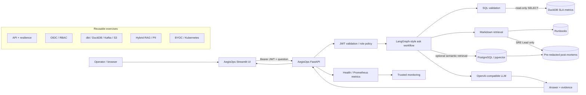
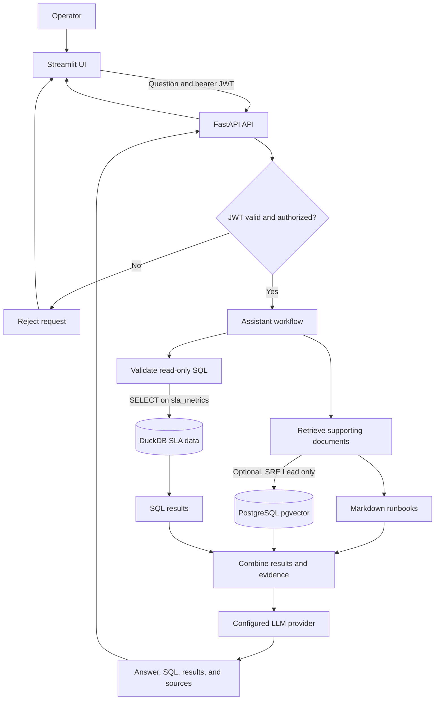

# FDE Stack Architecture

## Scope

The FDE Stack is a collection of focused Python, SQL, streaming, cloud, and
Kubernetes exercises organized in day-sized folders. It is primarily a
learning repository, not one continuously deployed application.

The Days 22-23 capstone, **AegisOps**, is the integrated flagship. The earlier
folders demonstrate dependencies and patterns that inform it. Some exercises
are standalone, while the BYOC folder is a Kubernetes/deployment scaffold that
is not a packaged copy of AegisOps.

## System overview

The hosted UI and API are separate services. The UI is an operator interface,
not an authorization boundary: protected API routes validate JWT signatures,
expiry, and roles.

## AegisOps runtime

### Components

| Component | Location | Responsibility |
| --- | --- | --- |
| Streamlit UI | [day22_23_aegisops-capstone/ui/app.py](day22_23_aegisops-capstone/ui/app.py) | Mint controlled demo JWTs, submit incident questions, and show answer evidence and control-plane metrics. |
| FastAPI API | [day22_23_aegisops-capstone/backend/aegisops/api.py](day22_23_aegisops-capstone/backend/aegisops/api.py) | Authenticate requests, enforce role checks, expose incident and telemetry endpoints, and construct service dependencies. |
| Ask workflow | [day22_23_aegisops-capstone/backend/aegisops/assistant.py](day22_23_aegisops-capstone/backend/aegisops/assistant.py) | Validate analytics SQL, retrieve runbooks/post-mortems, synthesize answers, and enforce evidence limits. |
| Metrics | [day22_23_aegisops-capstone/backend/aegisops/metrics.py](day22_23_aegisops-capstone/backend/aegisops/metrics.py) | Track HTTP, LLM, circuit-breaker, cost, and PII-redaction telemetry. |
| Ingestion helpers | [day22_23_aegisops-capstone/backend/aegisops/ingestion.py](day22_23_aegisops-capstone/backend/aegisops/ingestion.py) | Load CSV data into DuckDB and provide PII, embedding, and retrieval ingestion support. |
| Synthetic data | [day22_23_aegisops-capstone/data_seed](day22_23_aegisops-capstone/data_seed) | Generate alerts, synthetic post-mortems, tenant SLA measurements, and sample runbooks. |

### Request flow

The API opens the configured DuckDB file read-only. SQL is checked with
`sqlglot` before execution: only one `SELECT` against `sla_metrics` is allowed,
only a fixed set of aggregate functions is accepted, and result rows are capped
at 50.

Runbook Markdown is retrieved lexically. A pre-populated pgvector index can add
semantic retrieval of post-mortems, but it is optional; the API also works
without `POSTMORTEM_DATABASE_URL` or `NEON_DATABASE_URL`.
Post-mortem retrieval is restricted to `sre_lead`.

### API surface

| Method | Path | Purpose |
| --- | --- | --- |
| `GET` | `/health` | Return service health. |
| `GET` | `/metrics` | Export Prometheus instrumentation and AegisOps telemetry. |
| `POST` | `/api/v1/demo/token` | Mint a short-lived demo JWT when demo issuance is enabled. |
| `POST` | `/api/v1/ask` | Answer an incident question for a verified role. |
| `GET` | `/api/v1/control-plane` | Return protected latency, cost, circuit-breaker, and PII telemetry. |

Exact endpoint implementations and payload models are the source of truth in
[api.py](day22_23_aegisops-capstone/backend/aegisops/api.py).

### Trust and data boundaries

- **Identity:** `JWT_SECRET` must be at least 32 bytes. Demo issuance is disabled
  by default and is not a production identity provider.
- **Authorization:** the API is authoritative. UI role selection only requests
  a demo token and cannot grant backend access.
- **Analytics:** DuckDB is read-only for the application; SQL is allowlisted
  and limited to `sla_metrics`.
- **Documents:** local runbooks are Markdown files. Post-mortems must be
  pre-redacted before local use or indexed after PII redaction.
- **LLM and embeddings:** an OpenAI-compatible provider is selected through
  environment configuration. Questions, evidence, and provider traffic cross
  the provider boundary according to that deployment.
- **Telemetry:** `/metrics` is operationally sensitive and should be restricted
  to trusted monitoring systems.

### Configuration

The API reads:

| Variable | Purpose |
| --- | --- |
| `JWT_SECRET` | JWT signing secret; production deployments should use a trusted issuer and key-management flow. |
| `DEMO_TOKEN_ISSUER_ENABLED` | Enables the local demo token endpoint. |
| `DUCKDB_PATH` | Read-only SLA database; default is `data_seed/generated/aegisops.duckdb`. |
| `RUNBOOKS_DIR` | Local Markdown runbook directory. |
| `REDACTED_POSTMORTEMS_DIR` | Optional directory of pre-redacted local post-mortems. |
| `POSTMORTEM_DATABASE_URL` / `NEON_DATABASE_URL` / `DATABASE_URL` | Optional read-only pgvector retrieval connection. |
| `OPENAI_API_KEY`, `OPENAI_BASE_URL`, `OPENAI_CHAT_MODEL` | OpenAI-compatible synthesis provider. |
| `OPENAI_EMBEDDING_MODEL`, `OPENAI_EMBEDDING_DIMENSIONS` | Embedding provider and index shape. |
| `LLM_INPUT_COST_PER_1M`, `LLM_OUTPUT_COST_PER_1M` | Optional estimated cost rates. |

The UI uses `AEGISOPS_API_URL`, defaulting to `http://localhost:8000`.

### Deployment shape

The repository supports a separate Streamlit process and FastAPI process.
Render configuration is documented in the [AegisOps README](day22_23_aegisops-capstone/README.md);
the Dockerfile in the capstone folder packages the UI.

[day22_23_aegisops-capstone/deploy](day22_23_aegisops-capstone/deploy) is
currently reserved for future Helm assets and has no deployable chart.

## Learning modules

Each module is independent unless a README explicitly describes a cross-folder
integration.

| Days | Module | Architecture responsibility | Runtime state |
| --- | --- | --- | --- |
| 1-2 | [FastAPI ingestion](day1_2_fastapi) | Request validation, normalization, correlation IDs, and incident acceptance. | Process-local list; no database or authentication. |
| 3 | [Flaky legacy resilience](day3_flaky_legacy) | Retry/backoff, jitter, and circuit-breaker behavior for a mock upstream. | In-process MockTransport and random failures. |
| 4 | [OIDC/RBAC gateway](day4_oidc_and_rbac) | Demo JWT issuance, signature/expiry checks, and route role dependencies. | Shared demo secret; mock issuer; no real IdP. |
| 5-7 | [Operations console](day5_7_ops_ui) | Streamlit triage, KPI, filtering, and simulated remediation UI. | In-memory Pandas data; UI-only role state. |
| 8-9 | [Dirty data analytics](day8_9_data_analytics) | SQL cleaning, deduplication, type/amount validation, and Parquet export. | In-memory DuckDB plus generated CSV/Parquet files. |
| 10 | [dbt warehouse](day10_warehouse_modelling) | Seed loading, staging model, source contract, and dbt tests. | Local DuckDB profile outside the repository. |
| 11-12 | [Kafka DLQ exercise](day11_12_kafka_dlq) | Pydantic event validation and valid/DLQ routing. | In-memory lists; no Kafka/Redpanda connection. |
| 13-14 | [S3/SQS ingestion](day13_14_awslocal_tf) | LocalStack object notification, SQS worker, CSV cleaning, PostgreSQL upsert, and DLQ. | Terraform, LocalStack, and external PostgreSQL required. |
| 15-16 | [Hybrid RAG](day15_16_hybrid_search_rag) | Heading chunking, embeddings, pgvector/BM25-style retrieval, RRF ranking, and answer generation. | PostgreSQL/pgvector plus an external Groq-compatible LLM setup. |
| 17 | [RBAC and PII](day17_rbac_pii_redaction) | Presidio redaction and JWT-role-filtered RAG endpoint. | Requires Day 4-style JWT, pgvector, spaCy, and Groq. |
| 18-19 | [LangGraph agent](day18_19_langraph_otel_llm) | Intent routing, fixed safe SQL, runbook retrieval, grounding, abstention, and traces. | DuckDB/PostgreSQL plus Phoenix; no paid LLM in the default path. |
| 20-21 | [BYOC/air-gap scaffold](day20_21_airgapp_byoc_k8ns) | Zarf package metadata, Hardened Kubernetes placeholders, NetworkPolicies, and a Helm scaffold. | Deployment teaching scaffold, not verified AegisOps packaging. |
| 22-23 | [AegisOps capstone](day22_23_aegisops-capstone) | Integrated role-aware SLA/runbook/post-mortem assistant and observability. | Render-capable separate API/UI processes. |

## Cross-module integrations

The folders show patterns, while some explicit integrations exist:

- Days 15 and 17 share PostgreSQL document chunks and role/retention concepts.
- Day 17 validates tokens using the Day 4 JWT conventions and redacts prompts
  and retrieved context.
- Day 18 uses the fixed-SQL and runbook patterns demonstrated in earlier
  analytics and RAG exercises.
- AegisOps independently combines the mature forms of DuckDB analytics,
  runbook retrieval, PII controls, JWT/RBAC, provider-agnostic LLM access, and
  operational metrics.
- The Day 20-21 Kubernetes files demonstrate deployment constraints; they do
  not include the AegisOps API/UI implementation.

## Data flows

### Operational analytics

1. Synthetic or uploaded claims/SLA data enters a file or database.
2. SQL transforms normalize identifiers and statuses and remove invalid rows.
3. Warehouse staging or DuckDB exposes a trusted analytical view.
4. AegisOps opens only the SLA table through read-only, allowlisted queries.

### Streaming ingestion

1. S3 object creation publishes an event to SQS in the LocalStack exercise.
2. The worker downloads CSV content and validates it with DuckDB.
3. Valid rows upsert into PostgreSQL; failed SQS deliveries remain for retry
   and then reach the configured DLQ.

### Retrieval and synthesis

1. Documents are chunked or split at Markdown boundaries.
2. PII-redaction logic removes supported entities before use or indexing.
3. Lexical and optional vector retrieval find relevant evidence.
4. Role policy is applied before evidence reaches the prompt.
5. The configured LLM receives the evidence and produces a synthesis.

## Reliability and security principles

- Fail close to the data boundary: validate before persistence or retrieval.
- Use bounded retries and backoff for unreliable upstream services.
- Route poison messages to a DLQ rather than blocking later events.
- Keep analytical query tools fixed or allowlisted, never caller-SQL driven.
- Enforce authorization in the API or service, not only in UI state.
- Redact personal data before embedding or sending evidence to an external
  provider.
- Keep production secrets, database credentials, and provider keys outside
  source control.
- Restrict monitoring and private data planes to trusted networks.

## Repository boundaries and limitations

- The exercises contain generated artifacts, demo credentials, and mock
  infrastructure; they are not a single production deployment.
- Several modules are process-local and lose state on restart.
- The Day 4 and capstone demo issuers use self-contained JWT signing and must
  not replace a trusted OIDC identity provider.
- The Day 20-21 BYOC manifest has placeholder workloads and hard-coded demo
  database configuration.
- NetworkPolicies require a CNI that enforces them and need cluster-specific
  DNS/namespace verification.
- The hosted/demo provider boundary depends on deployment configuration;
  customer-controlled inference requires selecting an appropriate endpoint and
  controlling network egress.
- `/metrics`, database URLs, JWT secrets, and LLM credentials must be handled
  according to the security requirements of the target environment.
