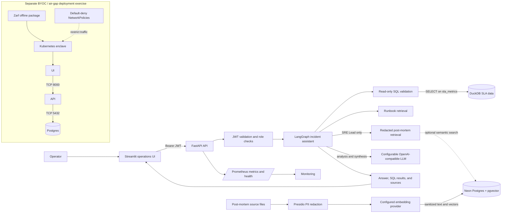

# FDE Stack

**A hands-on enterprise platform engineering journey — from API ingestion and
resilient services to a role-aware incident assistant, with security and
customer-controlled deployment patterns along the way.**

The flagship project is **AegisOps**, an incident assistant for SRE teams. It
combines SLA analytics, runbook retrieval, optional search over redacted
post-mortems, role-aware access, and operational telemetry. The surrounding
projects build up the engineering patterns behind it as focused, runnable
exercises.

## System architecture

The AegisOps runtime and BYOC exercise are related learning projects, not one
claim of a single production deployment. Semantic retrieval is optional; the
API can also retrieve local runbooks and uses DuckDB for SLA metrics.

## Security and deployment decisions

- **Authorization at the API:** the UI's role switcher is a demo convenience,
  not a security boundary. The API validates bearer JWTs and applies role
  checks; the public demo-token issuer is disabled by default and is only for
  controlled demos. Production deployments should use a trusted identity
  provider and signing keys.
- **Constrain data access:** the assistant opens DuckDB read-only and validates
  generated SQL to one `SELECT` against `sla_metrics`, with a maximum of 50
  rows. Only the SRE Lead role can retrieve post-mortems.
- **Redact before indexing:** post-mortems pass through Presidio before
  embedding or storage. For a deployment with a vector index, configure the
  API with read-only database credentials and use separate ingestion
  credentials to write the index.
- **Keep monitoring scoped:** `/metrics` exposes operational telemetry and
  should only be reachable by trusted monitoring systems.
- **BYOC / air-gap path:** [the Kubernetes exercise](day20_21_airgapp_byoc_k8ns)
  demonstrates packaging with Zarf and default-deny network policies. The
  example permits only required UI-to-API, API-to-Postgres, and DNS traffic.
  The hosted demo runs on Render; it is not an air-gapped deployment.
- **Provider boundary is explicit:** AegisOps accepts an OpenAI-compatible
  endpoint configuration. Inference and embedding requests go to that
  configured provider, so select a customer-controlled/on-prem endpoint or
  block external egress when required by a BYOC or air-gap environment.

These are educational examples, not a production security certification.
Review identity, secrets, network policy enforcement, data handling, and
provider egress for your own environment.

## Projects

| Days | Focus | Project |
| --- | --- | --- |
| 1–2 | API design and ingestion | [FastAPI ingestion service](day1_2_fastapi) |
| 3 | Resilience patterns | [Flaky legacy integration](day3_flaky_legacy) |
| 4 | Identity and authorization | [OIDC and RBAC gateway](day4_oidc_and_rbac) |
| 5–7 | Operations UI | [Operations console](day5_7_ops_ui) |
| 8–9 | Data quality and analytics | [DuckDB cleanup workflow](day8_9_data_analytics) |
| 10 | Warehouse modelling | [dbt staging models](day10_warehouse_modelling) |
| 11–12 | Streaming reliability | [Kafka dead-letter queue](day11_12_kafka_dlq) |
| 13–14 | Cloud infrastructure and ingestion | [LocalStack, SQS, and Terraform](day13_14_awslocal_tf) |
| 15–16 | Retrieval-augmented generation | [Hybrid search and RAG](day15_16_hybrid_search_rag) |
| 17 | PII and access control | [RBAC and PII redaction](day17_rbac_pii_redaction) |
| 18–19 | Agent workflows and observability | [LangGraph, OpenTelemetry, and LLM evaluation](day18_19_langraph_otel_llm) |
| 20–21 | Customer-controlled deployment | [Air-gapped BYOC on Kubernetes](day20_21_airgapp_byoc_k8ns) |
| 22–23 | Capstone | [AegisOps incident assistant](day22_23_aegisops-capstone) |

Each project includes its own README with setup and implementation details.

## Run the flagship project

The quickest way to try AegisOps is the **[live demo](https://fde-stack.onrender.com/)**.
The Render free-tier service may take longer to respond after an idle period;
the UI also requires its API service to be reachable.

For local setup, seed data, configuration, and deployment instructions, see
the [AegisOps README](day22_23_aegisops-capstone/README.md). It documents
Python requirements, environment variables, API/UI startup, and tests.

## Learning goals

- Build dependable APIs and recover gracefully from unreliable dependencies.
- Apply authentication, authorization, privacy guardrails, and read-only data
  access.
- Operate data pipelines, retrieval workflows, and LLM-powered tools with
  useful telemetry.
- Explore customer-controlled packaging and network-isolated Kubernetes
  deployment.
